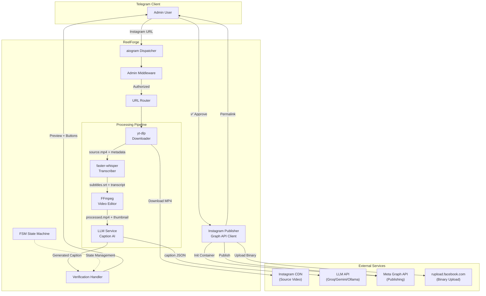
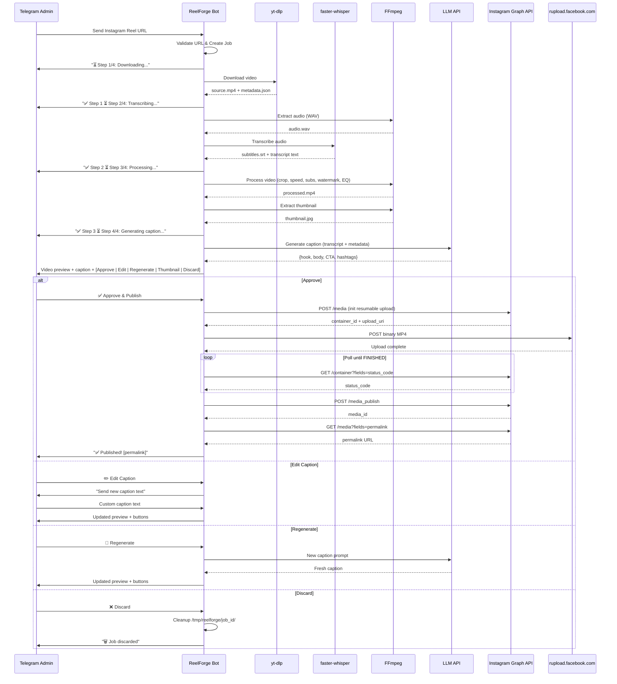
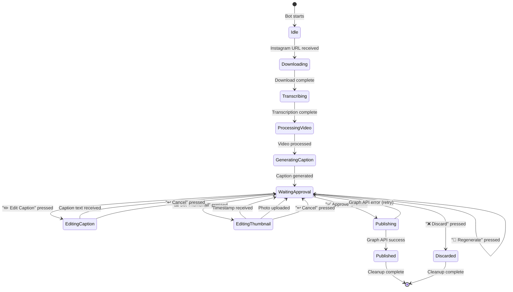
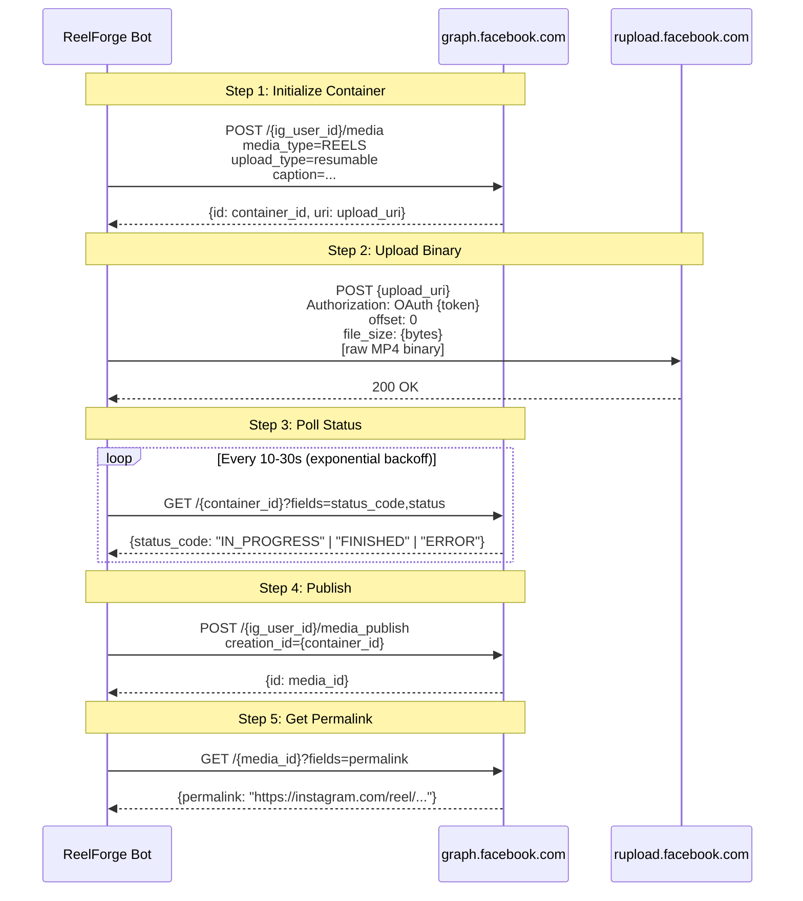

# ReelForge Architecture

> System architecture, data flow, FSM state diagram, and FFmpeg filter breakdown.

---

## System Architecture Overview



---

## Data Flow Sequence



---

## FSM State Diagram



---

## FFmpeg Transformation Pipeline

### Video Filter Chain

```
Input (any resolution/fps)
    │
    ├── setpts=0.9803*PTS          ← +2% speed increase
    │
    ├── scale=1112:1978             ← ~3% zoom (overshoot target)
    │   force_original_aspect_ratio=increase
    │
    ├── crop=1080:1920              ← Center-crop to exact 9:16
    │
    ├── fps=30                      ← Normalize framerate
    │
    ├── subtitles='subtitles.srt'   ← Burn-in (if speech detected)
    │   force_style='Fontname=Montserrat,Fontsize=18,...,MarginV=75'
    │
    └── drawtext=text='@handle'     ← Watermark overlay
        fontsize=36, y=110, white@0.85, box=black@0.4
```

### Audio Filter Chain

```
Input Audio
    │
    ├── atempo=1.02                 ← Match +2% video speed
    │
    ├── highpass=f=65               ← Remove sub-bass rumble
    │
    ├── lowpass=f=15500             ← Remove ultra-high frequencies
    │
    └── equalizer=f=3000            ← Subtle mid-range boost
        width_type=h, width=200, g=1.5
```

### Encoding Parameters

| Parameter | Value | Purpose |
| :--- | :--- | :--- |
| `-c:v libx264` | H.264 | Universal compatibility |
| `-crf 22` | Constant Rate Factor | Quality/size balance |
| `-preset fast` | Encoding speed | Good speed/compression ratio |
| `-pix_fmt yuv420p` | Pixel format | Maximum device compatibility |
| `-profile:v high` | H.264 profile | Modern device support |
| `-c:a aac` | AAC audio | Instagram-compatible |
| `-b:a 128k` | Audio bitrate | Good quality at small size |
| `-ar 48000` | Sample rate | Standard for video |
| `-map_metadata -1` | Strip metadata | Remove source fingerprints |
| `-movflags +faststart` | Fast start | Progressive streaming |

### Why These Transforms Matter

1. **Speed Shift (+2%):** Alters every frame timestamp and audio sample, generating a unique media fingerprint that differs from the source
2. **Scale + Crop (3% zoom):** Changes pixel data across every frame, preventing pixel-perfect hash matching
3. **Audio EQ:** Modifies the frequency spectrum imperceptibly to human ears but creates a distinct audio fingerprint
4. **Metadata Stripping:** Removes all container-level metadata that could link back to the source
5. **Subtitle Burn-In:** Adds visual data to every frame in the subtitle regions
6. **Watermark:** Identifies your brand and further differentiates the pixel content

---

## Instagram Graph API Resumable Upload Flow


